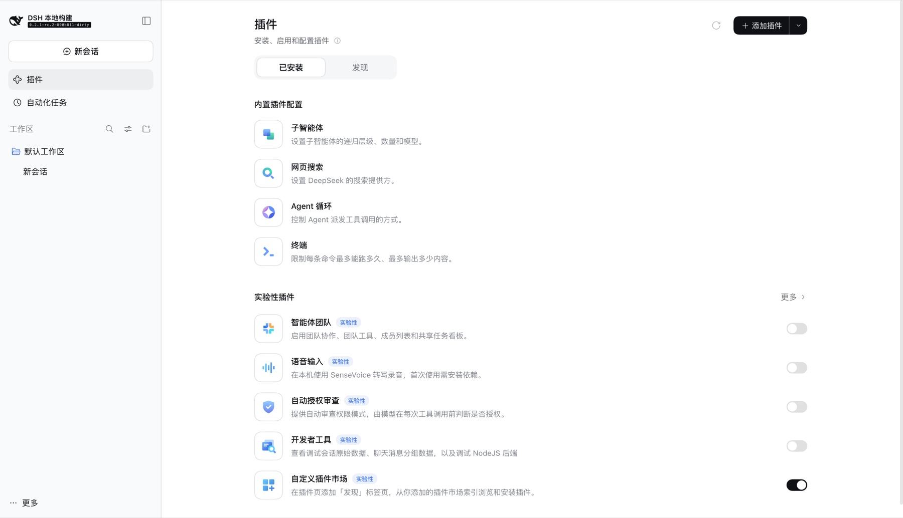
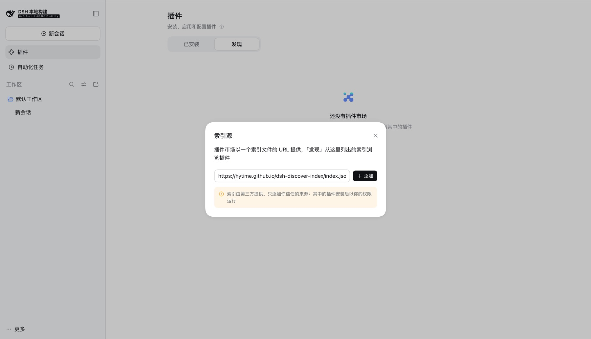
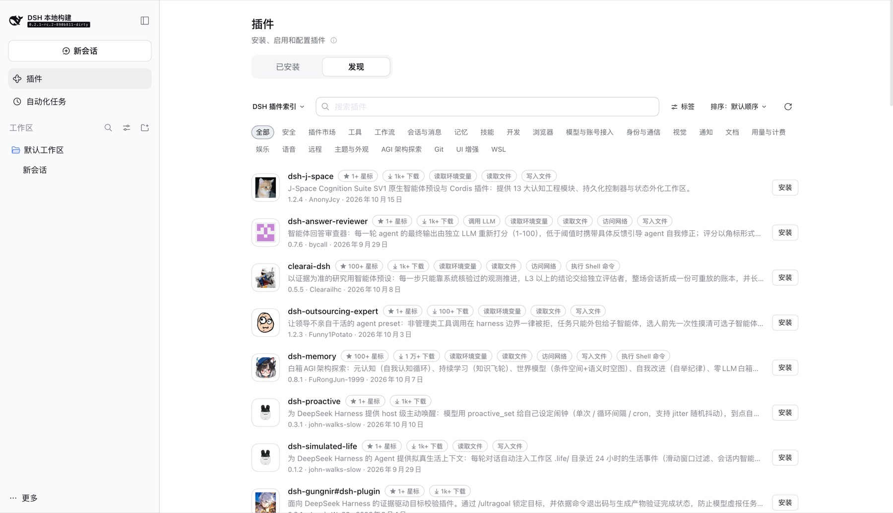
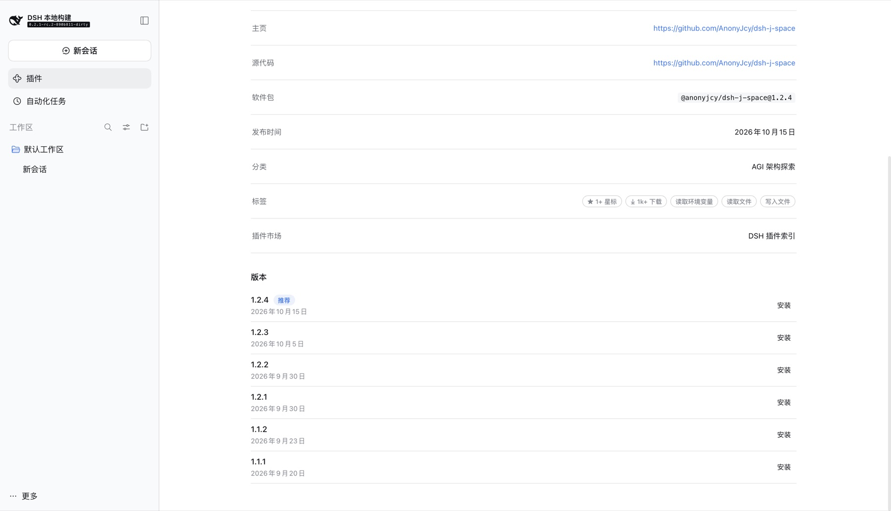

# dsh-discover-index

English | [中文](README.zh.md)

Aggregates the live [awesome-dsh-plugin](https://awesome-dsh-plugin.com/) catalog into
**plugin market index format 1** — the JSON document the [DeepSeek Harness](https://github.com/deepseek-ai/deepseek-harness)
(DSH) Discover tab reads.

Published index: <https://hytime.github.io/dsh-discover-index/index.json>

> [!IMPORTANT]
> **This project is a conversion and aggregation source, not a security review.**
> Every entry in the index is third-party data republished from upstream. Nothing here
> audits, sandboxes, or endorses the plugins it lists. Installing a DSH plugin runs
> third-party code inside your harness; review the plugin's source before you install it.

## Status

Published and automated. The index URL above serves a live document, rebuilt daily by
[`build.yml`](.github/workflows/build.yml) and deployed only after the real
`@deepseek-ai/dsh-plugin-market-index` validator accepts it.

| Check | Result |
| --- | --- |
| TypeScript | compiles clean |
| Tests | 354 passing, offline, against fixtures recorded from the live catalog |
| Published index | 5,452 plugins, format 1, accepted by the real validator |
| Automation | daily cron, plus `workflow_dispatch` for a manual rebuild |

The pipeline reads the live catalog, so the plugin count moves by a few entries between
runs as upstream gains, loses, and re-pins repositories. That is expected. See
[Running locally](#running-locally).

## What it produces

`dist/index.json` — a single format-1 document, published at
<https://hytime.github.io/dsh-discover-index/index.json>. Additional **profiles** declared
in `config/config.yml` each produce their own document (for example a star-floor subset
published as its own market), and each is validated independently in CI.

### What the market declares

Format 1 lets a market publish its own curated vocabulary, and Discover renders all of
it. This market uses each axis:

| Axis | What is declared | What it gives you in Discover |
| --- | --- | --- |
| `metadata.categories` | Upstream's 23 categories, translated | The category pills above the list |
| `metadata.labels` | Permission capabilities, risk findings, popularity buckets | The **Labels** filter menu and the tags on each card |
| `metadata.sortKeys` | `stars`, `downloads`, `added` | **Sort** menu entries, each opening descending |
| `metadata.keywords` | Runtime identity, category, and capability words | Free-text search recall |

**Labels** are the most useful of the four, because they answer questions the upstream
catalog cannot. They come from three places:

- **Capabilities** — upstream's trust scan reports what each plugin's code can reach:
  `fs-read`, `fs-write`, `network`, `shell`, `env`, `credentials`, `llm`,
  `host-runtime`, `dynamic-code`, `subagent`. Filtering for `shell` finds every plugin
  that can run commands on your machine.
- **Risk findings**, normalised into five classes rather than the 86 raw sentences
  upstream publishes (most name a single domain or IP): `risk:credentials-and-network`
  (476 entries), `risk:plaintext-http` (97), `risk:literal-ip` (47),
  `risk:install-time-code` (22), and `risk:dynamic-code`.
- **Popularity buckets** — `stars:1k+` / `100+` / `10+` / `1+` / `0` and
  `downloads:10k+` / `1k+` / `100+` / `1+` / `0`.

Popularity is bucketed rather than exact, and that is a format constraint: a label id is
declared once and *referenced* by plugins, so there is no per-plugin label value. Exact
values would need 235 labels for stars and 1,690 for downloads, which turns the filter
menu into an unusable list. The exact numbers are still there where they matter — they
are the `stars` and `downloads` sort keys, and DSH hands them to the model through its
`plugin_market` tool.

### Sources

| What | Where |
| --- | --- |
| Upstream catalog (the data) | <https://awesome-dsh-plugin.com/plugins.json> · [awesome-dsh-plugin/awesome-dsh-plugin](https://github.com/awesome-dsh-plugin/awesome-dsh-plugin) |
| Version history (npm) | <https://registry.npmjs.org/> — one document per npm package |
| This converter (the code) | <https://github.com/hytime/dsh-discover-index> |
| Published index (what DSH reads) | <https://hytime.github.io/dsh-discover-index/index.json> |

The index is a **conversion** of the upstream list, not an independent registry. Upstream
curates and hosts the catalog; this repository only converts it to format 1, checks it
against the real validator, and republishes it on a daily schedule. A bad entry should be
reported upstream; a bad *conversion* of a good entry belongs here.

### Version history

Upstream names exactly one version per entry. DSH's plugin page lists every version it can
install and refuses those the running DSH does not satisfy through `engines.dsh` — neither
of which means anything with a single version per plugin. The build therefore reads each
npm package's registry document and lists every version that declares `dsh.bundle`, is not
deprecated, and has a publish time (2,607 documents, roughly 150 MB on a cold run).

Git-resolved plugins still list the one version their pinned commit declares. A registry
that cannot be reached is not fatal: the plugin keeps its upstream version, because losing
a plugin to a registry outage would be worse than showing one version of it.

### Provenance in the document

The published document carries that provenance in its own `description`, so the source
travels with the data and is visible in Discover without consulting this README:

```json
"description": {
  "en": "The awesome-dsh-plugin list converted to the plugin market index format 1. Source: https://github.com/hytime/dsh-discover-index",
  "zh": "由 awesome-dsh-plugin 列表转换而来的插件市场索引（格式 1）。源码：https://github.com/hytime/dsh-discover-index"
}
```

## How upstream data maps to format 1

Upstream `plugins.json` is a curated list with its own schema; format 1 has a stricter
one. The aggregator converts entry by entry, and the two install paths differ:

| Upstream entry | Format-1 result |
| --- | --- |
| Names an npm package (`npm` + `version`) | One version with `source: { "type": "npm" }`. The package name is authoritative — it is what the registry actually serves — and installation needs no build step on the user's machine. The name is taken from the package, never inferred from the repository name. |
| Git-only (no npm package) | The repository is resolved, its manifest read, and one version emitted with `source: { "type": "git", "url": …, "commit": "<40-hex SHA>" }`. The commit is **pinned**, never a branch or tag, so an index entry always resolves to immutable code. |
| Monorepo subdirectory | The repository and the package directory are split into `repository.directory` (display) and `source.path` (install). |
| Cannot be resolved to a real package name and version | **Dropped.** Format 1 requires a non-empty `versions` array, so an unresolvable entry is never emitted as an empty shell. `node dist/cli.js doctor` reports every drop and why. |

Other mapping rules:

- **Display metadata** — titles, descriptions, icons, author, and repository come from
  upstream and from the package manifest. Descriptions are kept per language.
- **Sort keys** — `stars`, `downloads`, and the date the entry joined the list become
  numeric sort keys, which is what the Discover tab's sort menu lists. A value upstream
  does not publish is omitted rather than written as `0`.
- **Publish time** — the registry's own publish time when it is known, falling back to
  the date the entry joined the upstream list.
- **Deny list** — `config/config.yml` names repositories and packages that must never
  appear. DeepSeek Harness itself is on that list: the harness declares a bundle and
  would otherwise pass every structural check, and listing the product inside a list of
  plugins for the product is the one wrong entry every visitor would notice.

### Example

This is a representative excerpt of the output. It passes
`parseMarketIndex` from `@deepseek-ai/dsh-plugin-market-index` unchanged:

```json
{
  "format": 1,
  "title": { "en": "DSH Plugin Index", "zh": "DSH 插件索引" },
  "description": {
    "en": "The awesome-dsh-plugin list converted to the plugin market index format 1. Source: https://github.com/hytime/dsh-discover-index",
    "zh": "由 awesome-dsh-plugin 列表转换而来的插件市场索引（格式 1）。源码：https://github.com/hytime/dsh-discover-index"
  },
  "metadata": {
    "categories": {
      "agi": { "title": { "en": "AGI Architecture Exploration", "zh": "AGI 架构探索" } },
      "session": { "title": { "en": "Sessions & Messages", "zh": "会话与消息" } }
    },
    "labels": {},
    "sortKeys": {
      "stars": { "title": { "en": "Stars", "zh": "星标" }, "order": "desc" }
    }
  },
  "plugins": [
    {
      "name": "dsh-session-steward",
      "title": { "en": "dsh-session-steward", "zh": "dsh-session-steward" },
      "description": { "en": "Session Steward for DSH.", "zh": "面向 DSH 的会话管家。" },
      "author": "drscrewdriver",
      "homepage": "https://github.com/drscrewdriver/dsh-session-steward",
      "repository": { "url": "https://github.com/drscrewdriver/dsh-session-steward" },
      "metadata": {
        "category": "session",
        "keywords": [],
        "labels": [],
        "sortKeys": { "stars": 1 }
      },
      "versions": [
        {
          "version": "0.5.2",
          "publishTimestamp": 1758153600,
          "source": { "type": "npm" },
          "engines": {}
        }
      ]
    },
    {
      "name": "dsh-quality-review",
      "title": { "en": "dsh-quality-review", "zh": "dsh-quality-review" },
      "author": "CAI-MH",
      "repository": { "url": "https://github.com/CAI-MH/dsh-quality-review" },
      "metadata": { "keywords": [], "labels": [], "sortKeys": { "stars": 2 } },
      "versions": [
        {
          "version": "0.1.0",
          "publishTimestamp": 1757116800,
          "source": {
            "type": "git",
            "url": "https://github.com/CAI-MH/dsh-quality-review",
            "commit": "3f1c9a2b7d4e50618c9b2a7f4d3e1c0b9a8f7e6d"
          },
          "engines": {}
        }
      ]
    }
  ]
}
```

Note one rule this example has to obey: every plugin `category` id must appear in
`metadata.categories`, or the validator rejects the document.

## Using it in DSH Discover

The Discover tab is **experimental**, and custom markets are gated behind a separate
switch that ships as part of the experimental plugin-markets bundle.

### 1. Switch on Custom plugin markets

Open **Plugins** and switch on **Custom plugin markets** under **Experimental plugins**.
The Plugins page gains **Installed** and **Discover** tabs.



### 2. Add the index source

Open **Discover** → **Add index source** and paste:

```
https://hytime.github.io/dsh-discover-index/index.json
```

That is the only URL needed. It serves a complete format-1 document; there is no
companion manifest or API to configure.



### 3. Browse the market

The market is **DSH 插件索引**. The category pills, the **Labels** filter, and the
**Sort** menu are all declared by the index itself, so they appear the moment the source
is added — nothing in DSH has to know what this market contains.



### 4. Open a plugin

A plugin's page lists every version the index carries, with the recommended one marked,
and shows the declared labels under **Labels**.



Once more than one source is added, use the **market menu** to switch between them. Each
configured profile is a separate index and therefore a separate market.

Switching markets is a client-side operation because each profile is published as its
own complete index — no DSH change is needed to add a market. Marketplace titles,
descriptions and plugin metadata are third-party text and carry no endorsement; the
`description` above names this repository so the provenance is visible in that list.

> These screenshots come from a DSH 0.2.1-rc.2 instance whose only market is this index,
> so what they show is this index and nothing else. The categories, labels, sort keys,
> and version list are all rendered from the published document.

## Configuring a source

A source is one entry in `config/config.yml`. Its `kind` picks the adapter that knows how
to read the document; its `fields` mapping says where that document keeps the things the
pipeline turns into labels, keywords, and sort keys.

The shipped configuration reads the upstream catalog with no mapping at all, because that
adapter already knows the upstream shape:

```yaml
sources:
  - id: awesome-dsh-plugin
    kind: upstream-catalog
    enabled: true
    url: https://awesome-dsh-plugin.com/plugins.json
    minStars: 0
    priority: 10
```

### Pointing at a document that names things differently

`fields` is what makes a second catalog a configuration change rather than a code change.
Every path is dot-separated and may be omitted; anything omitted contributes nothing.
This example reads a catalog that nests its trust facts under `security` and publishes its
own `score`:

```yaml
sources:
  - id: other-catalog
    kind: upstream-catalog
    enabled: true
    url: https://example.test/catalog.json
    minStars: 0
    priority: 5
    fields:
      capabilities: security.permissions   # -> labels such as `shell`
      redLines: security.warnings          # -> normalised `risk:` labels
      keywords: topics                     # -> extra search terms
      sortKey:
        path: score                        # -> a numeric sort key…
        id: score                          #    …published under this id
```

| Key | What it points at | What it becomes |
| --- | --- | --- |
| `capabilities` | An array of permission ids, such as `["shell", "network"]` | One label per id, plus each id and its words as keywords |
| `redLines` | An array of prose findings | One `risk:` label per recognised class; unrecognised sentences are ignored |
| `keywords` | An array of discovery words | Extra search terms, on top of the identity keywords and the category |
| `sortKey.path` | A number | A sort key, so Discover gains a menu entry that orders by it |
| `sortKey.id` | — | The id the key is published and referenced under |

Two rules are enforced at load time, because both failure modes are silent otherwise:

- **An empty path segment is rejected.** `security..permissions` would resolve to nothing
  and the source would appear to publish no capabilities at all.
- **A `sortKey` needs both `path` and `id`.** A value with no id cannot be referenced; an
  id with no value would advertise a sort option that orders nothing.

A path that simply does not exist in the document is not an error — the entry keeps its
other facts and contributes no labels from that member. That is deliberate: one wrong
path should cost you the labels it pointed at, not the whole run.

### Declaring what the index publishes

A custom sort key is declared automatically from the candidates that carry it, so a
configured `sortKey` appears in Discover's **Sort** menu without further work. The same
applies to labels: every label a plugin references is declared, and every declaration has
a localized title, falling back to the id for a vocabulary this project has not seen.

### Adding a source that needs a new adapter

Configuration cannot invent a document format. When the catalog is not one the existing
adapters can read:

1. Add an adapter module under `src/sources/` that turns the fetched document into
   `Candidate[]` (see `src/sources/upstream-catalog.ts`).
2. Register its `kind` in `KNOWN_SOURCE_KINDS` in `src/config.ts` — configuration naming
   an unregistered kind is rejected on purpose, so a typo cannot silently disable a source.
3. Add the entry under `sources:` and reference its `id` from a `profiles:` entry to
   publish it, or from an existing profile to merge it into one market. Lower `priority`
   wins when two sources yield the same package name.

A new source must yield real npm package names and exact versions for npm entries.
For git-only entries, pin a commit SHA. Guessing a name from a repository name is wrong
twice over: repository names are not unique across owners, and many carry uppercase
letters that an npm package name may not contain.

### Publishing a second market

Each `profiles:` entry produces its own document and therefore its own market in Discover:

```yaml
profiles:
  - id: curated
    title: { en: Curated Plugins, zh: 精选插件 }
    sources: [awesome-dsh-plugin, other-catalog]
    minStars: 100
    output: curated.json
```

Profiles may share sources; the same plugin appearing in two markets is fine, because the
documents are independent. `minStars` and each source's own `minStars` both apply — the
profile uses the higher of the two.

## Running locally

Node 22, pnpm 9+.

```bash
pnpm install                 # install dependencies exactly as CI does
pnpm run build               # compile TypeScript to dist/
node dist/cli.js build       # fetch upstream and write dist/index.json (+ profiles)
node dist/cli.js doctor      # per-entry rejections and why
node dist/cli.js sources     # list configured sources
pnpm test                    # unit tests
pnpm run typecheck           # typecheck without emitting
```

The lockfile is `pnpm-lock.yaml` and is committed; CI installs with
`pnpm install --frozen-lockfile`, so a dependency change must update the lockfile in the
same commit.

Nothing requires a local clone of the upstream list: `plugins.json` is read live, because
a local copy trails the live catalog badly.

`DSH_DISCOVER_UPSTREAM_URL` overrides the catalog URL, which is useful for testing
against a recorded response without touching `config/config.yml`.

To reproduce exactly what the workflow gates on, run the validator the way CI does:

```bash
node -e "import('@deepseek-ai/dsh-plugin-market-index').then(m=>{const fs=require('fs');const doc=JSON.parse(fs.readFileSync('dist/index.json','utf8'));const v=m.parseMarketIndex(doc,'https://hytime.github.io/dsh-discover-index/index.json');console.log('valid, plugins='+v.plugins.length)})"
```

## Automation

| Workflow | Trigger | What it does |
| --- | --- | --- |
| [`build.yml`](.github/workflows/build.yml) | daily cron, `workflow_dispatch` | Builds the index, refuses to publish if it holds fewer than 2000 plugins, validates it with the real validator, then uploads `dist/` and deploys to Pages. |
| [`validate.yml`](.github/workflows/validate.yml) | pull request, push to `main` | Typecheck, tests, build, and a full index build that must validate. No deploy, no Pages permission. |

A bad index can never replace a good one: the validation step runs before the artifact
upload, the deploy job needs the build job to succeed, and a new run cancels an in-flight
one via `concurrency` with `cancel-in-progress`.

## License

[MIT](LICENSE) © 2026 hytime

Upstream catalog data belongs to its authors and is republished under their terms.
